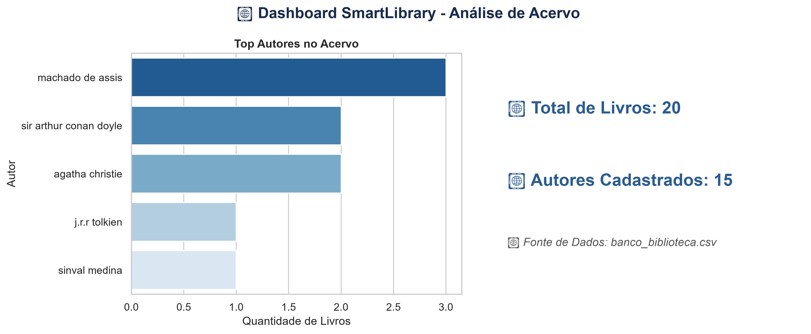

# 📚 SmartLibrary - Gerenciador de Acervo & Pipeline de Dados

O **SmartLibrary** é uma aplicação em Python desenvolvida para o gerenciamento de leitura pessoal, estruturando um pipeline completo de dados: da ingestão interativa via linha de comando à persistência local e visualização de métricas de acervo.

---

## 📊 Dashboard Analítico

---

## 🚀 Funcionalidades

- **Ingestão Interativa (CLI):** Entrada contínua de livros e autores via linha de comando (`app.py`).
- **Tratamento de Dados com Pandas:** Estruturação e higienização automática do acervo.
- **Persistência em CSV:** Armazenamento resiliente e local no arquivo `banco_biblioteca.csv`.
- **Geração de Dashboard (Matplotlib / Seaborn):** Script automatizado (`gerar_dashboard.py`) para geração dos KPIs de acervo.

---

## 🛠️ Tecnologias Utilizadas

- **Linguagem:** Python 3.x
- **Manipulação de Dados:** Pandas
- **Visualização de Dados:** Matplotlib & Seaborn

---

## 📌 Roadmap de Desenvolvimento

- [x] **v1.0:** Ingestão CLI, persistência local em CSV com Pandas e gerador de dashboard analítico.
- [ ] **v2.0:** Integração resiliente com provedor de LLM para motor de recomendação literária generativa.